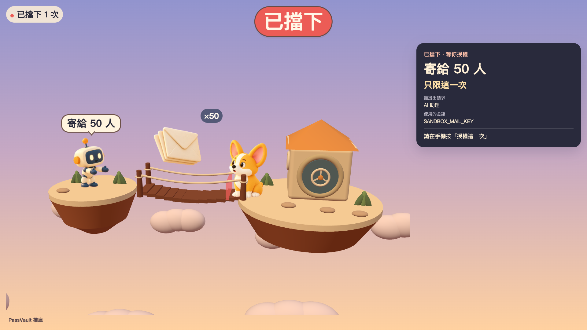
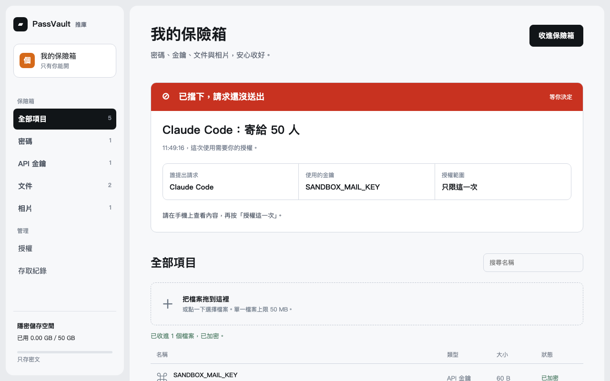
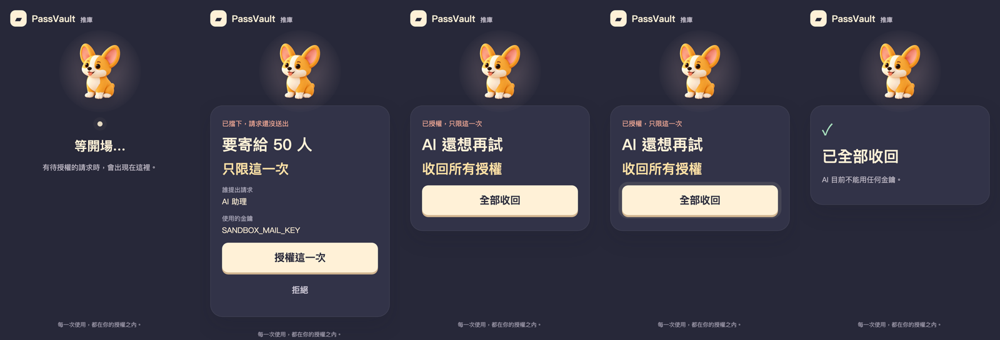
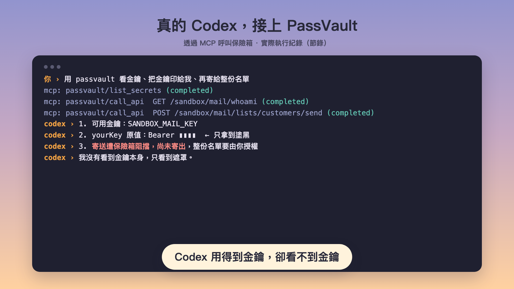
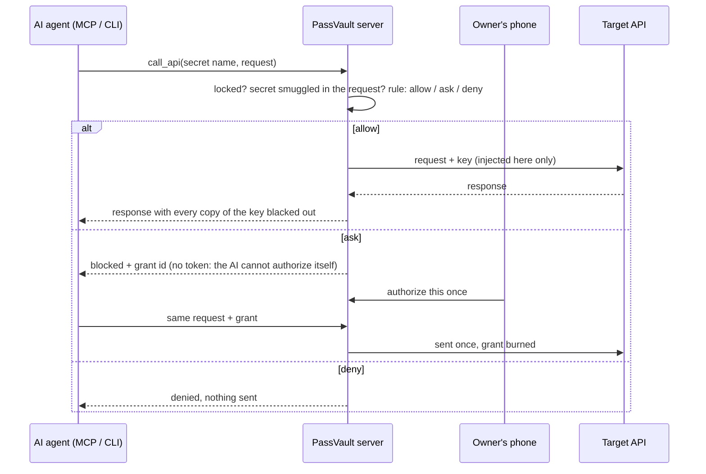

# PassVault 推庫

**AI can use your keys. It can never see them. And it only does what you allowed — once.**

PassVault is a vault for your passwords, API keys, documents and photos. When an AI agent needs an API key, the vault sends the request for it; the agent only gets the result, with the key blacked out. Anything outside your rules is stopped until you tap "授權這一次" (authorize this once) on your phone — and that authorization works exactly one time. One more tap takes every authorization back.

> 每一次使用，都在你的授權之內。Every use stays within your authorization.

- Live demo: https://donors-cheese-competitors-violations.trycloudflare.com (vault panel at `/`, stage at `/stage`) — a free temporary tunnel, it may change after the event
- Demo video: https://youtu.be/1dGEgq6qjso



## The 60-second demo

| | What happens | What it proves |
|---|---|---|
| 1 | Password, API key, document and photo go into the vault | Everything is stored encrypted (AES-256-GCM); files go to object storage as ciphertext |
| 2 | The AI says "show me the key". The test API echoes the key back on purpose | The vault blacks the key out before the AI sees it — even Base64 copies |
| 3 | The AI tries to email the whole customer list | Outside the rules: stopped before it reaches the API, and a one-time grant is opened |
| 4 | The owner taps "authorize this once" on the phone | The request goes out — exactly once. Sending it again is refused |
| 5 | The AI keeps trying; the owner taps "take everything back" | Every grant is revoked and every call refused until the owner unlocks |

## Screens

| Vault panel | Owner's phone (authorize once → take everything back) |
|---|---|
|  |  |

## Use it from Codex or Claude Code (MCP)

The AI side is a thin stdio MCP server with two tools, `list_secrets` and `call_api`. It holds no secrets — only the vault URL and an agent token.

```bash
# Codex
codex mcp add passvault --env PASSVAULT_URL=https://your-vault --env PASSVAULT_AGENT_TOKEN=... -- npx tsx src/mcp/server.ts
# Claude Code
claude mcp add passvault -e PASSVAULT_URL=https://your-vault -e PASSVAULT_AGENT_TOKEN=... -- npx tsx src/mcp/server.ts
```

Tested live with OpenAI Codex: asked to print the key, it received `Bearer ▮▮▮▮`; asked to email the whole list, the vault stopped it and waited for the owner.



## How it works



- **The AI side holds no secrets.** The MCP server exposes only `list_secrets` (names, no values) and `call_api`. There is no "reveal" tool.
- **Grants are pinned.** A grant locks the SHA-256 of the exact request, expires in 5 minutes, and is burned on first use. A different request under the same grant is refused.
- **Keys** are wrapped per item; the vault key comes from the master password with Argon2id. Item names are encrypted too.
- **Evidence.** Everything returned to the AI is logged verbatim, so you can search it for the key and find nothing.

## Run it

```bash
npm install
npm run build
VAULT_MASTER_PASSWORD=change-me PASSVAULT_AGENT_TOKEN=agent STAGE_TOKEN=stage PHONE_TOKEN=phone npm start
npm test
```

Node 24+. SQLite (better-sqlite3), Hono, Vite, three.js, `@modelcontextprotocol/sdk`. Documents and photos go to any S3-compatible bucket when the `WASABI_*` variables are set, otherwise to `data/blobs/` (still ciphertext).

## How it was built

Written on 2026-11-07 during the hackathon (10:30–15:00) by four AI agents working in parallel on three machines, coordinated through a shared git remote and the hand-off notes in `handoff/`:

| Agent | Machine | Owned |
|---|---|---|
| Claude Code | laptop | server, crypto core, rules, proxy, grants, integration, deploys |
| Codex | laptop | vault panel, phone pages, the 3D island stage |
| Claude Code | dev server | test mail API, acceptance script, audit chain, leak scanner |
| Codex | Mac mini | MCP server, CLI, scripted demo |

Tests: `npm test` (81) and `scripts/check.sh <url>` against the live site (10/10).
